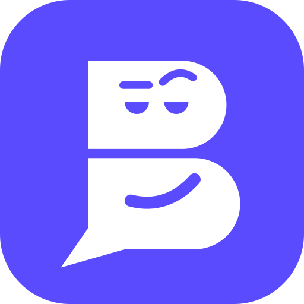

# Bants server

Self-hosted backend for **Bants**, a WhatsApp-style messaging app. It runs as one small Docker container on Unraid and has **no npm dependencies**. It uses Node 22's built-in SQLite, HTTP server and crypto.

**Features:** accounts, usernames and friend codes, contact requests, 1:1 and group chats, real-time delivery over WebSocket, typing indicators, delivered/read receipts, online/last seen, photos/videos/files, edit and delete for everyone, blocking, and Android push notifications via Firebase.

> Messages are stored unencrypted in the database on your server (`/data/bants.db`). Traffic is encrypted in transit by HTTPS through Cloudflare Tunnel.

---

## 1. Put it on GitHub

1. The code lives at [wellsey001/Bants](https://github.com/wellsey001/Bants).
2. The **Build Docker image** action runs the tests, then publishes `ghcr.io/wellsey001/bants:latest`.
3. On GitHub, go to **your profile → Packages → bants → Package settings** and set visibility to **Public**. This lets Unraid pull the image without logging in. You can keep the repo itself private.

## 2. Run it on Unraid

**Option A: template (recommended)**
1. Copy `unraid/bants-server.xml` to `/boot/config/plugins/dockerMan/templates-user/` on your Unraid flash drive. You can do this from the Unraid terminal or over SMB to the `flash` share.
2. In **Docker → Add Container**, choose **bants-server** from the Template dropdown.
3. Set an **Invite code**. Friends will need it to sign up. Then click **Apply**.

**Option B: compose.** If you use the Compose Manager plugin, use `docker-compose.yml`.

Check it's running by opening `http://YOUR-UNRAID-IP:8080/api/health`, which should show `{"ok":true}`.

Data is stored in `/mnt/user/appdata/bants-server`, which holds the database and a `media/` folder. Include it in your appdata backups.

## 3. Make it reachable outside your home (Cloudflare Tunnel)

1. In Cloudflare Zero Trust, go to **Networks → Tunnels** and create a tunnel. Install the `cloudflared` container on Unraid using the token it gives you.
2. Add a **Public hostname**, for example `chat.yourdomain.com`, pointing to **Service: HTTP**, `YOUR-UNRAID-IP:8080`.
3. WebSockets work through tunnels by default. The app then uses `https://chat.yourdomain.com` and `wss://chat.yourdomain.com/ws`.

## 4. Push notifications (optional, do this once the app exists)

1. Create a Firebase project and add an Android app with your app's package name.
2. Go to **Project settings → Service accounts → Generate new private key**, which downloads a JSON file.
3. Put the file at `/mnt/user/appdata/bants-server/firebase-service-account.json`.
4. Set the container variable `FCM_SERVICE_ACCOUNT=/data/firebase-service-account.json` and restart the container.

The server only sends a push when the user has no live WebSocket connection, which usually means the app is closed or in the background. Pushes are data-only, so the app decides how to show the notification.

## Settings

| Variable | Default | Meaning |
|---|---|---|
| `PORT` | `8080` | Port to listen on |
| `DATA_DIR` | `/data` | Database and media location |
| `INVITE_CODE` | *(blank)* | If set, required to register |
| `ALLOW_REGISTRATION` | `true` | `false` closes sign-ups |
| `MAX_UPLOAD_MB` | `50` | Upload size limit |
| `FCM_SERVICE_ACCOUNT` | *(blank)* | Firebase JSON path; push is off if blank |
| `TRUST_PROXY` | `true` | Read real client IPs from Cloudflare headers |
| `LOG_REQUESTS` | `false` | Log every HTTP request |

## Running locally / tests

```
npm start          # needs Node 22.5+
npm test           # spins up a temp server and runs 19 end-to-end checks
```

---

# API reference

Every request except register, login, health and server info needs the header `Authorization: Bearer <token>`. You can also pass `?token=` in the URL, which is handy for image loaders. Errors look like `{ "error": "message", "code": "optional_code" }`.

### Auth
| | |
|---|---|
| `POST /api/auth/register` | `{ username, password, displayName?, inviteCode?, deviceName? }` → `{ token, user }` |
| `POST /api/auth/login` | `{ username, password, deviceName? }` → `{ token, user }` |
| `POST /api/auth/logout` | Ends this device's session |
| `GET /api/server` | `{ registration: "open" \| "invite" \| "closed", maxUploadBytes }`, which lets the app show or hide the invite field |

Usernames are 3–24 characters long, using letters, numbers, `_` and `.`. They're case-insensitive. Passwords must be at least 8 characters.

### Me
| | |
|---|---|
| `GET /api/me` | Your profile, including `friendCode` (e.g. `K7QX-M2PA`) |
| `PATCH /api/me` | `{ displayName?, about?, avatar?: mediaId \| null }` |
| `POST /api/me/password` | `{ currentPassword, newPassword }`, which signs out other devices |
| `POST /api/me/friend-code/reset` | Get a new friend code. The old one stops working. |
| `POST /api/me/push-token` | `{ token }` is the FCM token for this device; send `null` to clear it |
| `DELETE /api/me` | `{ password }` deletes the account |

### Finding people and contacts
| | |
|---|---|
| `GET /api/users/lookup?username=bob` or `?friendCode=K7QX-M2PA` | Exact match only. Nobody can browse the user list. |
| `GET /api/users/:id` | Public profile |
| `POST /api/contacts/requests` | `{ username }` sends a request the other person must accept. `{ friendCode }` connects straight away, because having someone's code means they shared it with you. Returns `{ status: "requested" \| "accepted", ... }`. |
| `GET /api/contacts/requests` | `{ incoming: [...], outgoing: [...] }` |
| `POST /api/contacts/requests/:id/accept` | Returns the new contact and their 1:1 conversation |
| `POST /api/contacts/requests/:id/decline` | Declines an incoming request or cancels your own |
| `GET /api/contacts` / `DELETE /api/contacts/:userId` | List or remove contacts |
| `GET /api/blocks`, `POST /api/blocks/:userId`, `DELETE /api/blocks/:userId` | Block list |

Friend codes ignore case, spaces and dashes, so `k7qx m2pa` works. Online status and last seen are only visible to contacts.

### Conversations
| | |
|---|---|
| `GET /api/conversations` | All chats, newest first, each with `lastMessage`, `unreadCount`, `members` and `muted` |
| `POST /api/conversations` | `{ type: "direct", userId }` or `{ type: "group", name, memberIds, avatar? }` |
| `GET /api/conversations/:id` | One chat |
| `PATCH /api/conversations/:id` | `{ muted }` (anyone), or `{ name, avatar }` (group admins) |
| `POST /api/conversations/:id/members` | `{ userIds }`, admins only |
| `DELETE /api/conversations/:id/members/:userId` | Remove someone (admin), or use your own id to leave |
| `POST /api/conversations/:id/admins/:userId` | `{ admin: true \| false }` |

### Messages
| | |
|---|---|
| `GET /api/conversations/:id/messages?before=ID&limit=50` | Older history, returned oldest→newest |
| `GET /api/conversations/:id/messages?after=ID` | Newer messages |
| `POST /api/conversations/:id/messages` | `{ clientId, body?, media?, replyTo? }` |
| `PATCH /api/messages/:id` | `{ body }`. Edits work for 15 minutes on text messages only. |
| `DELETE /api/messages/:id` | Delete for everyone |
| `POST /api/conversations/:id/receipts` | `{ delivered?: messageId, read?: messageId }` |
| `GET /api/sync?since=ID` | Everything new across all chats. Call this after reconnecting. |

`clientId` is a random ID the app generates, such as a UUID. If a send is retried with the same `clientId`, the server returns the original message instead of creating a duplicate.

Message object: `{ id, conversationId, senderId, clientId, kind: text|image|video|audio|file|system, body, media, replyTo, createdAt, editedAt, deleted }`.

**Ticks:** each member has `lastDelivered` and `lastRead` message IDs. A message from you is ✓ when the server returns it, ✓✓ when every other member's `lastDelivered` ≥ its ID, and blue ✓✓ when every other member's `lastRead` ≥ its ID.

### Media
| | |
|---|---|
| `POST /api/media` | Raw file body with `Content-Type: image/jpeg` (etc.) and an optional `X-Filename` header → `{ id, mime, size }`. Then send a message with `media: id`. |
| `GET /api/media/:id` | Download. Supports `Range` for video seeking. Only chat members can download. |

---

## WebSocket: `wss://host/ws?token=<token>`

You can use an `Authorization` header instead of the query string. The server sends a ping every 30 seconds; standard WebSocket clients such as OkHttp answer it automatically.

**Server → app**
| `type` | Fields |
|---|---|
| `ready` | `user`, sent on connect. Call `/api/sync` now to catch up. |
| `message.new` | `message` |
| `message.updated` | `message`, for edits and deletes |
| `message.ack` | `clientId`, `message`, a reply to your `message.send` |
| `receipt` | `conversationId, userId, lastDelivered, lastRead` |
| `typing` | `conversationId, userId, typing` |
| `presence` | `userId, online, lastSeen` |
| `conversation.updated` / `conversation.removed` | `conversation` / `conversationId` |
| `contact.request` / `contact.request.removed` / `contact.added` | Request or contact details |
| `user.updated` | `user`, when a contact changes their name or picture |
| `error` | `error, code, clientId?` |

**App → server**
```json
{ "type": "message.send", "conversationId": 1, "clientId": "uuid", "body": "hi" }
{ "type": "typing", "conversationId": 1, "typing": true }
{ "type": "receipt", "conversationId": 1, "delivered": 42, "read": 42 }
{ "type": "ping" }
```

**Push payload** (FCM data message): `type: "message"` with `conversationId, conversationType, conversationName, messageId, senderId, senderName, kind, body`, or `type: "contact_request"` or `type: "contact_accepted"`.
